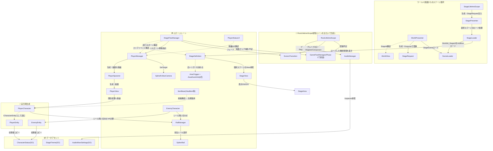
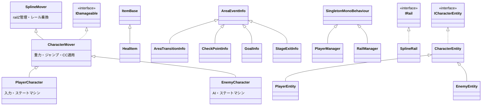

# クラス相関図

全体のクラス構成・参照関係・責務の地図。**クラスを追加・変更したらこの図も更新すること。**
(図はMermaid記法。Obsidian/GitHubでそのまま表示される)

## レイヤーと参照関係

矢印は「知っている・呼び出す」方向(A→B = AがBを参照)。実線=呼び出し/生成、点線=イベント購読。

## 継承・インターフェース

- 移動系の継承は「レール移動(SplineMover) → +物理(CharacterMover) → +入力/AI(Controller)」の積み上げ
- 汎用部品(Observer系): `CollisionObserver` / `AnimationEventObserver` / `AnimationStateObserver` は、UnityコールバックをObservableに変換してControllerに提供する独立部品([当たり判定](当たり判定の仕組み.md) / [アニメーション連携](アニメーション連携の仕組み.md))

## 責務早見表

| クラス | 層 | 担当 |
|---|---|---|
| `GameFlowManager`(予定) | ゲーム進行 | シーン遷移。Title/InStage/GameOver/Result([設計書](../specs/GameFlowManager設計書.md)) |
| `StageFlowManager` | ステージ進行 | エリア切替・リスポーン・失敗/クリアの検知と報告 |
| `StageDefinition` | Scene構成 | Additiveロードした個別ステージの固定構成。初期エリア・エリア一覧・トリガー一覧・Viewを保持 |
| `StageView` | Unity表現 | `StageArea`の表示ON/OFFを行う個別ステージSceneの窓口 |
| `StageArea` / `AreaTrigger` | ステージ構造 | エリアON/OFF・開始地点・イベント発火 |
| `PlayerManager` | 資源 | 残機・リスポーン地点。移行中の外部向けFacade |
| `PlayerSpawner` | 生成 | `PlayerView` Prefabの生成・破棄と現在のViewの保持 |
| `PlayerView` | Unity表現 | 既存`PlayerCharacter`への窓口。`SplineAnchor`への配置 |
| `PlayerCharacter` / `EnemyCharacter` | キャラクター | 入力/AI+ステートマシン |
| `CharacterMover` / `SplineMover` | 移動基盤 | 物理とレール移動([Spline移動の仕組み](Spline移動の仕組み.md)) |
| `RailManager` / `SplineRail` / `SplineGate` / `SplineAnchor` | レール | 担当レール選択・座標変換・地点マーカー |
| `CharacterStatus(SO)` / `PlayerEntity` / `EnemyEntity` | ステータス | 定義(SO)と実行時の値(Entity)。体は `ICharacterEntity` として読む([仕組み](キャラクターステータスの仕組み.md)) |
| `AudioManager` | 常駐サービス | BGM/SE再生(**現状呼び出し箇所ゼロ**。Phase 3で接続) |
| `ScreenTransition` | 常駐サービス | 画面フェード([仕組み](画面フェードの仕組み.md)) |
| `PlayerStatusUI` | UI | HP・残機表示(購読のみ。ロジックなし) |
| `ItemBase` / `HealItem` | アイテム | 接触検知と効果適用 |
| `RootLifetimeScope` | 起動・DI | 常駐サービスの保持と全シーン共通の登録([パターン解説](../learning/08_RootLifetimeScope常駐パターン.md)) |

## 設計原則(図を読む/描き足すときのルール)

1. **参照は上の層→下の層、イベントは下の層→上の層(Observable購読)** の一方通行。下の層が上の層のクラス名を知っていたら設計ミス
2. 進行の指揮者は `〜FlowManager`、資源の管理者は `〜Manager`([命名規約](../conventions/命名規約.md))
3. UnityコールバックはObserver部品でObservable化してから使う(直接OnTriggerEnter等を書かない)
4. UIは購読のみ。UIからゲームロジックを呼ばない(操作が必要になったらFlowManager経由)
