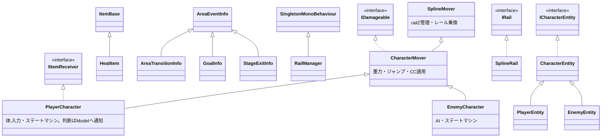

# クラス相関図

全体のクラス構成・参照関係・責務の地図。**クラスを追加・変更したらこの図も更新すること。**
(図はMermaid記法。Obsidian/GitHubでそのまま表示される)

## レイヤーと参照関係

矢印は「知っている・呼び出す」方向(A→B = AがBを参照)。実線=呼び出し/生成、点線=イベント購読。

```mermaid
graph TD
    subgraph boot["🔧 RootLifetimeScope常駐(シーンをまたいで生存)"]
        RootLifetimeScope
        AudioManager
        ScreenTransition
        SceneLoader
    end

    subgraph world["🗺 WorldScene"]
        WorldView
        WorldPresenter
    end

    subgraph stagescene["🎮 StageScene(ステージをまたいで生存)"]
        StageLifetimeScope
        StagePresenter
        StageModel
        StageLoader
        StageEventBus
        PlayerPresenter
        PlayerModel
        PlayerFactory
        PlayerEventBus
        StageHUDPresenter
        StageHUDView
        SplineFollowCamera
        EnemyFactory
    end

    subgraph stage["🏞 個別ステージScene(Additive)"]
        StageDefinition
        StageView
        StageArea
        AreaTrigger["AreaTrigger + AreaEventInfo派生"]
        EnemySpawnPoint
        RailManager
        SplineRail
        ItemBase["ItemBase(HealItem等)"]
    end

    subgraph runtime["⚡ 実行時生成"]
        PlayerView
        PlayerCharacter
        EnemyCharacter
        PlayerEntity
        EnemyEntity
    end

    subgraph data["📦 データアセット"]
        CharacterStatus["CharacterStatus(SO)"]
        StageTheme["StageTheme(SO)"]
        AudioMixerSettings["AudioMixerSettings(SO)"]
    end

    RootLifetimeScope -->|プレハブの子・RegisterComponent| AudioManager
    RootLifetimeScope -->|プレハブの子・RegisterComponent| ScreenTransition
    AudioManager -->|Inspector参照| AudioMixerSettings

    WorldPresenter -.->|StageId購読| WorldView
    WorldPresenter -->|暗転| ScreenTransition
    WorldPresenter -->|StageRequestをEnqueueしてStageSceneロード| SceneLoader

    StageLifetimeScope -->|生成・StageRequest注入| StagePresenter
    StagePresenter -->|ステージSceneロード| StageLoader
    StageLoader -->|Additiveロード・注入| StageDefinition
    StagePresenter -->|初期エリア・Viewを読む| StageDefinition
    StagePresenter -->|エリアidで指示・敵リセット| StageView
    StagePresenter -->|今のエリア・復帰地点| StageModel
    StagePresenter -->|Prepared / RespawnRequest| StageEventBus
    StagePresenter -.->|LifeConsumed購読| PlayerEventBus
    StageEventBus -.->|AreaTrigger購読| StagePresenter

    StageView -->|表示ON/OFF・敵生成| StageArea
    StageView -.->|全トリガーを束ねてEventBusへ| AreaTrigger
    StageArea -->|出現地点を読む| EnemySpawnPoint
    StageArea -->|生成| EnemyFactory
    EnemyFactory -->|Instantiate| EnemyCharacter

    PlayerPresenter -.->|Prepared / RespawnRequest購読| StageEventBus
    PlayerPresenter -.->|AttackReceived等購読| PlayerEventBus
    PlayerPresenter -->|判断(Damage/Kill/Heal/残機)| PlayerModel
    PlayerPresenter -->|生成| PlayerFactory
    PlayerFactory -->|Instantiate| PlayerView
    PlayerPresenter -->|PlaceAt / Die / SetEntity| PlayerView
    PlayerPresenter -->|SetTarget| SplineFollowCamera
    PlayerPresenter -->|死亡時の暗転・明転| ScreenTransition
    PlayerView -->|中継| PlayerCharacter
    PlayerView -->|事実の通知| PlayerEventBus
    PlayerModel -->|値を保持| PlayerEntity
    StageHUDPresenter -.->|HP/残機購読| PlayerModel
    StageHUDPresenter -->|表示| StageHUDView

    PlayerEntity -->|初期値コピー| CharacterStatus
    EnemyEntity -->|初期値コピー| CharacterStatus
    PlayerCharacter -.->|ICharacterEntityとして読む| PlayerEntity
    EnemyCharacter -->|生成・HP計算| EnemyEntity
    PlayerCharacter -->|レール問い合わせ| RailManager
    EnemyCharacter -->|レール問い合わせ| RailManager
    RailManager -->|担当レール選択| SplineRail

    ItemBase -->|IItemReceiver.ReceiveItem| PlayerCharacter
```

## 継承・インターフェース



- 移動系の継承は「レール移動(SplineMover) → +物理(CharacterMover) → +入力/AI(〜Character)」の積み上げ。性能値は `ICharacterEntity` から読む
- 汎用部品(Observer系): `CollisionObserver` / `AnimationEventObserver` / `AnimationStateObserver` は、UnityコールバックをObservableに変換して〜Characterに提供する独立部品([当たり判定](当たり判定の仕組み.md) / [アニメーション連携](アニメーション連携の仕組み.md))

## 責務早見表

| クラス | 層 | 担当 |
|---|---|---|
| `RootLifetimeScope` | 起動・DI | 常駐サービスの保持と全シーン共通の登録([パターン解説](../learning/08_RootLifetimeScope常駐パターン.md)) |
| `AudioManager` / `ScreenTransition` | 常駐サービス | BGM/SE再生 / 画面フェード([仕組み](画面フェードの仕組み.md)) |
| `WorldPresenter` / `WorldView` | ワールド選択 | ステージ選択 → 暗転 → StageSceneロード |
| `GameFlowManager`(予定) | ゲーム進行 | シーンをまたぐ進行。Title/InStage/GameOver/Result([設計書](../specs/GameFlowManager設計書.md)) |
| `StagePresenter` | ステージ進行 | ロード・エリア切替・リスポーン指示([仕組み](ステージ進行の仕組み.md)) |
| `StageModel` / `StageEntity` | ステージ状態 | 今いるエリアのidと復帰地点 |
| `StageLoader` | ロード | 個別ステージSceneのAdditiveロード・注入・確認用カメラの無効化 |
| `StageDefinition` | Scene構成 | 個別ステージSceneの入口。初期エリアとStageViewの在り処 |
| `StageView` | 統括View | エリア操作・トリガー集約・敵リセットの唯一の窓口(エリアidで指示を受ける) |
| `StageArea` / `AreaTrigger` / `EnemySpawnPoint` | パーツView | エリアON/OFF・開始地点 / イベント発火 / 敵の出現地点 |
| `PlayerPresenter` | プレイヤー進行 | 生成・作り直し・被弾/即死/アイテムをModelへ反映・死亡時の暗転 |
| `PlayerModel` / `PlayerEntity` | プレイヤー状態 | HP・残機・性能値(正)。ダメージ/回復/即死の判断 |
| `PlayerView` | Presenterとの窓口 | 生成・配置・Entityの受け渡し・体の事実をEventBusへ中継 |
| `PlayerCharacter` / `EnemyCharacter` | 体 | 入力/AI+ステートマシン。プレイヤーは判断せず通知だけ、敵はHP計算も自分で行う |
| `CharacterMover` / `SplineMover` | 移動基盤 | 物理とレール移動([Spline移動の仕組み](Spline移動の仕組み.md)) |
| `CharacterStatus(SO)` / `EnemyEntity` | ステータス | 定義(SO)と敵の実行時の値([仕組み](キャラクターステータスの仕組み.md)) |
| `StageHUDPresenter` / `StageHUDView` | UI | PlayerModelのHP・残機を表示(購読のみ) |
| `PlayerEventBus` / `StageEventBus` | 通知 | 発行者の領域ごとのバス(Player側の事実 / Stage側の判断) |
| `RailManager` / `SplineRail` / `SplineGate` / `SplineAnchor` | レール | 担当レール選択・座標変換・地点マーカー |
| `ItemBase` / `HealItem` | アイテム | 接触検知と効果データの受け渡し(適用はPlayerModel) |

## 設計原則(図を読む/描き足すときのルール)

1. **参照は上の層→下の層、イベントは下の層→上の層(Observable購読)** の一方通行。下の層が上の層のクラス名を知っていたら設計ミス
2. ステージ内の進行はPresenter(StagePresenter/PlayerPresenter)、シーンをまたぐ進行は `〜FlowManager`、常駐サービスは `〜Manager`([命名規約](../conventions/命名規約.md))
3. UnityコールバックはObserver部品でObservable化してから使う(直接OnTriggerEnter等を書かない)
4. UIは購読のみ。UIからゲームロジックを呼ばない(操作が必要になったらPresenter経由)
5. EventBusは発行者の領域で選ぶ(Player側の事実はPlayerEventBus、Stage側の判断はStageEventBus)。通知名は出した時点で確定している事実に合わせる
